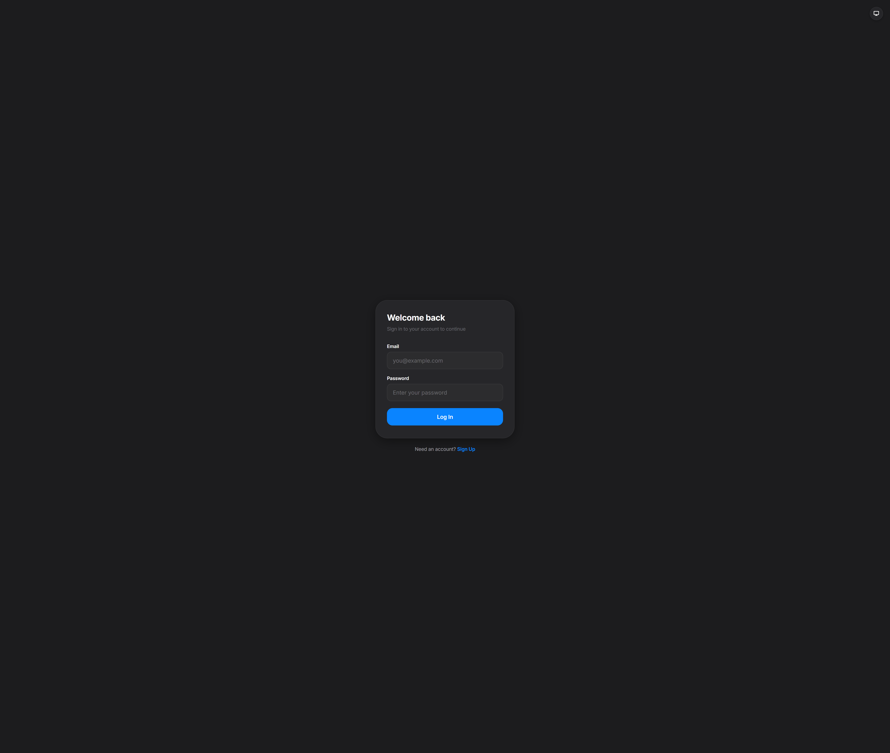
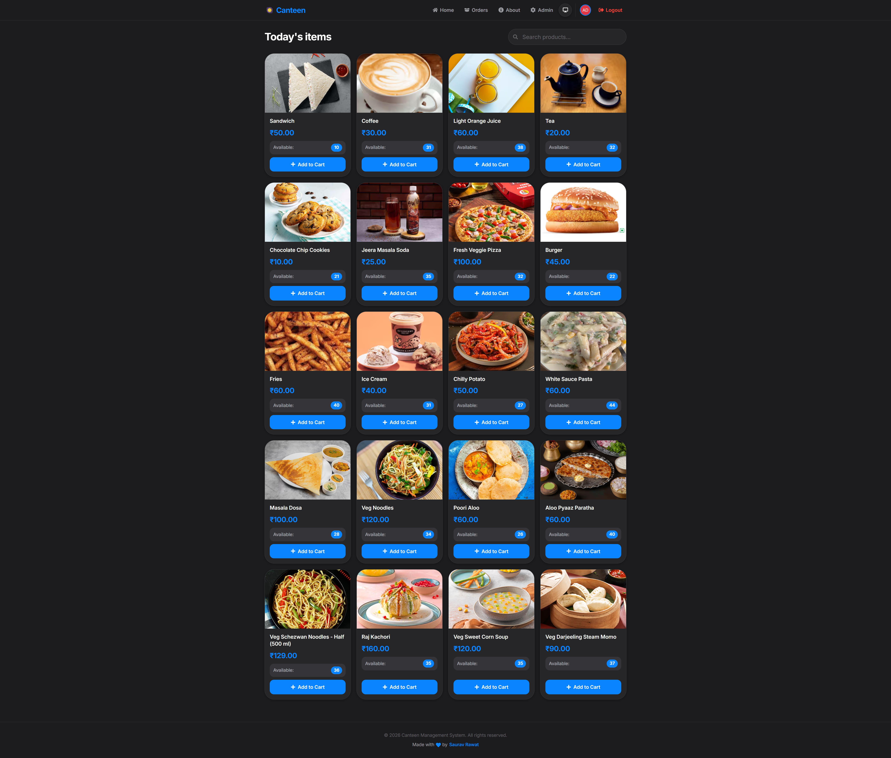

# Canteen Management

A web app for browsing a canteen menu, placing orders, and managing products and sales. Built with React and Firebase.

[](https://sauravrwt.github.io/Canteen-Management/)

## Screenshots

<p align="center">
  
  
</p>

## Features

- Browse and search the available menu.
- Add products to a cart and place orders.
- Review order history and export it as a PDF.
- Manage products and inventory as an administrator.
- View sales summaries, charts, and best-selling products.
- Sign in and sign up with Firebase Authentication.
- Use the app on desktop and mobile screens.

## Built with

- [React](https://react.dev/) and [Vite](https://vite.dev/)
- [Firebase Authentication](https://firebase.google.com/docs/auth) and [Realtime Database](https://firebase.google.com/docs/database)
- [React Bootstrap](https://react-bootstrap.netlify.app/) and [Bootstrap](https://getbootstrap.com/)
- [Recharts](https://recharts.org/) for charts
- [jsPDF](https://github.com/parallax/jsPDF) for PDF exports

## Getting started

### Prerequisites

- [Node.js](https://nodejs.org/) and npm
- A Firebase project with Authentication, Realtime Database, and the `isUserAdmin` callable Cloud Function configured

### Install

```bash
git clone https://github.com/SauRavRwT/Canteen-Management.git
cd Canteen-Management
npm install
```

### Configure Firebase

1. Create a Firebase project and register a web app.
2. Enable the sign-in provider used by the app (email and password).
3. Create a Realtime Database.
4. Copy `env.example` to `.env` and fill in the Firebase web app configuration values:

   ```bash
   cp env.example .env
   ```

   In PowerShell, use `Copy-Item env.example .env` instead.

5. In Firebase Authentication, create an account for the administrator and copy its UID.
6. Open `src/Database/Database.json`, replace the `admins.AdminUserId` placeholder with the administrator's UID, then import the JSON into the Realtime Database.
7. Deploy the callable `isUserAdmin` Cloud Function in `functions/index.js` to the same Firebase project.
8. Configure and review Realtime Database security rules for your app and user roles before using real data. Do not use open read/write rules in production.

The `.env` file is ignored by Git. Vite exposes `VITE_` variables in the client bundle, so Firebase web configuration values are not server-side secrets; protect data with Firebase security rules and restrict API keys where appropriate.

### Run locally

```bash
npm run dev
```

Open the local URL printed by Vite (by default, <http://localhost:5173/Canteen-Management/>).

## Available scripts

| Command | Description |
| --- | --- |
| `npm run dev` | Start the local development server |
| `npm run build` | Create a production build in `dist/` |
| `npm run preview` | Preview the production build locally |
| `npm run lint` | Run ESLint |

## Contributing

Contributions are welcome. Fork the repository, create a branch for your changes, and open a pull request with a clear description of the update.
